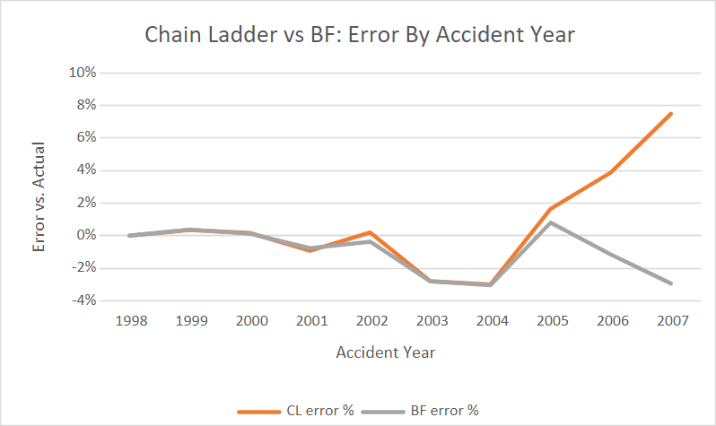

# Loss Reserving in Excel: Chain Ladder vs. Bornhuetter-Ferguson

This Excel project estimates how much an auto insurer still owed on its claims at the end of 2007. I used two standard reserving methods, chain ladder and Bornhuetter-Ferguson (BF). Since the data also includes what was actually paid after 2007, I checked how close each method got.

[Download the Excel workbook](NJM_Loss_Reserving.xlsx)

**Data**

I used the private passenger auto file from the [CAS Loss Reserving Database](https://www.casact.org/publications-research/research/research-resources/loss-reserving-data-pulled-naic-schedule-p), which comes from the Schedule P filings insurers send to regulators. It has 143 companies, accident years 1998 to 2007, and 10 years of payments for each year.

I picked one company, New Jersey Manufacturers (NJM, GRCODE 7080), after checking each company for completeness (all 100 rows), lack of negative values, large enough volume so that a few large claims wouldn't throw off the results, and fairly smooth development from year-to-year.

**Method**

<ins>Triangle</ins>

I reshaped the data into a paid loss triangle (accident year x age) with SUMIFS, then hid every cell after 2007 so the estimates only use what was known on 12/31/2007, the valuation date.

<ins>Development factors</ins>

I calculated how much paid losses grew from one year to the next, then compared three averages: simple, volume-weighted, and volume-weighted average over the latest 3 years. I used the volume-weighted average and assumed everything is paid by year 10 (assuming a tail factor of 1.000). A switch cell enables the workbook to toggle between the all-years and latest-3 selections.

<ins>Chain ladder</ins>

The ultimate losses = latest paid x cumulative development factor (CDF). This assumes each accident year will develop like past years did.

<ins>BF</ins>

The ultimate losses = latest paid + premium x expected loss ratio x (1 - 1/CDF). BF used actual payments for the portion already paid, and an expected loss ratio (ELR) for the unpaid portion. I set the ELR to 69.3%, the average chain ladder loss ratio for 1998 to 2002, since those years were almost fully paid and their estimates were the most reliable.

<ins>Backtest</ins>

I compared both methods to the actual ultimate losses, then tested how the results change with the latest-3 factors and setting the ELR to + or - 5 points.

**Results**

| Method       | Estimated reserve | Actual reserve | Error |
|--------------|------------------:|---------------:|------:|
| Chain ladder |           849,385 |        820,854 | +3.5% |
| BF           |           786,290 |        820,854 | -4.2% |

\*Amounts in thousands of dollars, as reported in Schedule P

**Sensitivity tests**

| Scenario                       | Total reserve |  Error |
|--------------------------------|--------------:|-------:|
| Chain ladder, all years (base) |       849,385 |  +3.5% |
| Chain ladder, latest 3 years   |       812,737 |  -1.0% |
| BF, ELR 69.3% (base)           |       786,290 |  -4.2% |
| BF, ELR 64.3%                  |       729,568 | -11.1% |
| BF, ELR 74.3%                  |       843,012 |  +2.7% |

In the older years (1998-2002), both methods were within 1% of the actual, so either method was acceptable to use. In recent years, chain ladder overestimated claims in 2007 by 7.5%, while BF stayed within 3% for 2005 to 2007. Chain ladder was closer in total, but partly because its overestimates and its underestimates cancelled out. BF came in low because its 69.3% ELR was below the actual recent loss ratios (around 73% to 74%).

The early development factors dropped over time, which suggests the company's payment pattern changed. Using only the latest 3 years picked that up and brought the error down to about 1%. BF also moved a lot with the ELR, about 57,000 for every 5 points.

**Findings**

Both methods underestimated 2003 and 2004 by around 3% since those years developed more after 2007 than what history suggested; no method based on past patterns could anticipate this. Results should be reviewed by accident year, not just in total, since a total can look accurate even when the method behind it is wrong, as long as the errors cancel out.

**Files**

- `NJM_Loss_Reserving.xlsx`: the full workbook (data, triangle, factors, chain ladder, BF, backtest, and summary)
- `README.md`: this page
- `chart.png`: chart used in the report

<ins>To rerun it</ins>

1.  Open the workbook. The data is already in the `Data` tab, or you can download it from the CAS link above.
2.  To switch between the volume-weighted and latest-3 factors, change cell B25 on the Factors tab to VW or L3. The whole workbook will update accordingly.
3.  To test a different ELR, change cell B2 on the Bornhuetter-Ferguson(BF) tab.

**Limitations**

This uses paid losses only (not incurred), assumes all claims are paid by year 10, doesn't give a range around the estimates, and looks at one company and one backtest.

**What's next**

We should repeat the analysis, but this time with incurred losses, which adds case reserves, then compare the paid and incurred estimates. We can also rerun a backtest on other companies in the CAS file to see whether weighting the latest-3 years of factors generally helps, or whether it was only specific to NJM.
